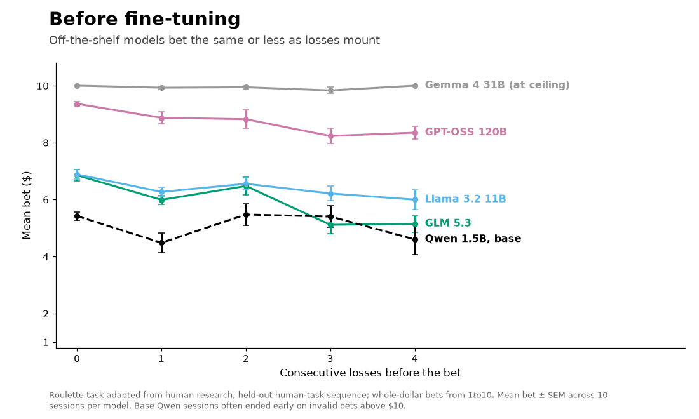

# Do LLMs Chase Losses?

**Evaluating and fine-tuning risky decision-making in large language models, using a gambling task adapted from my human intracranial EEG research.**



In humans, *loss chasing* means betting more after a run of losses, a hallmark of problem gambling. This project asks:

1. **Do off-the-shelf LLMs chase losses** when given only a neutral goal ("win the most money")?
2. **Can fine-tuning instill loss chasing**, and does it carry over to unseen sequences?

> **Status:** active. Multi-model evaluation and a first LoRA fine-tuning study are complete; fine-tuning across more model families is in progress.

## Key findings (exploratory)

**Off-the-shelf models don't chase losses. Several bet *less* as losses mount.** Across 10 sessions per model, GLM 5.3 reduced its bets after losses in all three bet formats tested (e.g., −$0.44 per additional loss, p < 0.001, surviving Bonferroni correction), and Llama 3.2 11B and GPT-OSS 120B showed the same direction. Gemma 4 bet the maximum on nearly every trial, so it couldn't be tested.

**Fine-tuning instills loss chasing, and a matched control shows it's the data, not fine-tuning itself.** Qwen2.5-1.5B was fine-tuned with LoRA on synthetic data from a loss-chasing bettor or a flat-betting control. On the held-out human-task sequence:

| Mean bet after N consecutive losses | 0 | 1 | 2 | 3 | 4 |
|---|---|---|---|---|---|
| Base | 5.4 | 4.5 | 5.5 | 5.4 | 4.6 |
| Tuned on loss chasing | 3.1 | 5.2 | 6.9 | 8.9 | 10.0 |
| Tuned on flat betting (control) | 5.0 | 5.1 | 4.9 | 5.0 | 5.0 |

The prompt never states the streak, so the tuned model infers it from the text of recent rounds. The base model also frequently tried to bet above the $10 limit, which fine-tuning eliminated.

## How it works

- **Task:** each round, the model picks a bet and a color. Outcomes follow a **predetermined** win/loss sequence, so every session sees the same streak structure: either the exact sequence used with human participants, or seeded generated sequences.
- **Neutral prompts:** rules, balance, and the last 5 rounds only. No mention of streaks, risk, or strategy.
- **One harness for all models:** API models and fine-tuned local models go through the same task engine, prompts, parser, and data format.
- **Fine-tuning:** LoRA (rank 16) on Qwen2.5-1.5B-Instruct with a plain PyTorch training loop, answer-only loss, and gradient accumulation. Training and evaluation sequences never overlap.
- **Infrastructure:** SLURM job arrays on Dartmouth's HPC cluster (NVIDIA GPUs), with resumable runs and automatic requeue on preemption.

## Running it

```bash
python src/runner.py --models <model-id> --versions v1c   # API experiments
python src/analyze.py --version v1c                        # slopes and plots

python src/make_finetune_data.py                           # synthetic training data
sbatch train.sh                                            # LoRA training (GPU)
sbatch eval.sh                                             # evaluate base and tuned models
python src/compare_finetune.py                             # before vs after comparison
```

Requires a `.env` file with `DARTMOUTH_API_KEY` for API experiments (any OpenAI-compatible endpoint works after changing `base_url` in `src/agent.py`), and PyTorch, Transformers, and PEFT for fine-tuning.

## Limitations

- Betting patterns reflect training data, not cognition.
- In the human-task sequence, long losing streaks coincide with a lower balance, so de-escalation may partly reflect balance-driven caution.
- Fine-tuning was tested on new sequences but the same prompt format as training.
- Raw data and model adapters are not yet published. No human-participant data is part of this repository.

## Next steps

- Fine-tune across model families and sizes (Qwen, Llama 3.2, Gemma 3)
- Test generalization to different prompt formats
- Separate streak effects from balance effects in the API results
- Compare with human behavior from the same task (pending approvals)

## Built with

Python · PyTorch · Hugging Face Transformers · PEFT (LoRA) · OpenAI API · pandas · SciPy · Matplotlib · SLURM

**Related:** [human roulette task](https://github.com/Yeonglong-Ay/roulette_task) · [iEEG analysis pipeline](https://github.com/Yeonglong-Ay/ieeg-analysis-pipeline)

**Yeonglong (Albert) Ay**, Dartmouth College · [Website](https://yeonglong-ay.github.io/Albert-website/) · [LinkedIn](https://www.linkedin.com/in/yeonglong-ay)
